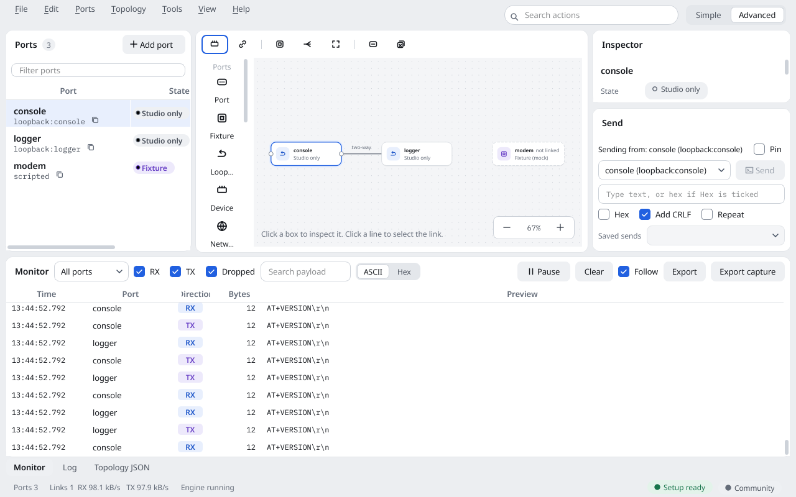

---
# The home page of the product site (docs/plan/site.md, section 3). The sentence under the name is the one that docs/icl-app.json
# carries for the company site's tile (summary), and mkdocs.yml (site_description) repeats it.
template: marketing.html
title: Virtual Serial Studio
title_tag: "Virtual Serial Studio: virtual serial ports and a traffic monitor"
description: "Virtual serial ports, port sharing, a traffic monitor and test automation on one computer. For Windows, Linux and macOS, free under the GPL."
---
<section class="icl-hero icl-hero--app">

<h1>Virtual Serial Studio</h1>

Virtual serial ports, port sharing, a traffic monitor and test automation on one computer.

<a class="icl-button" href="downloads/">Download</a><a class="icl-button icl-button--ghost" href="guide/">Read the guide</a>

<ul class="icl-tags"><li>Windows, Linux and macOS</li></ul>

<figure class="vss-hero-shot"><picture><source srcset="images/site/advanced-diagram-dark.png" media="(prefers-color-scheme: dark)"></picture></figure>

</section>

<section class="icl-section">

<h2>What you can do with it</h2>

Each card goes to a page that shows how Studio does the job, and what the job does not cover.

<ul class="icl-grid vss-grid-3">
<li><article class="icl-card">
Virtual ports
<h3><a href="solutions/develop-and-test-without-hardware/">Give a program a serial port</a></h3>
Make a port for your program, or two ports joined like a null-modem cable, before the device exists or while it is somewhere else.
</article></li>
<li><article class="icl-card">
Port sharing
<h3><a href="solutions/sharing-and-bridging-ports/">Share and bridge ports</a></h3>
Give one real device to several programs, merge several senders into one device, share a bus, or put a port on the network.
</article></li>
<li><article class="icl-card">
Traffic monitor
<h3><a href="solutions/capture-and-analysis/">Watch and record traffic</a></h3>
See every byte on every port, in text or hex, record it with its time, export it, and play a recording back.
</article></li>
<li><article class="icl-card">
Device emulation
<h3><a href="solutions/develop-and-test-without-hardware/">Answer like a device</a></h3>
Make a port reply from a script, or poll like a master, and replay what a device sent, with a delay you choose.
</article></li>
<li><article class="icl-card">
Test automation
<h3><a href="solutions/test-automation-and-ci/">Run tests with no window</a></h3>
Run a saved setup from a terminal or a CI job, drive ports from a script, wait for a reply and keep a test report.
</article></li>
<li><article class="icl-card">
Test benches
<h3><a href="solutions/test-automation-and-ci/">Build a bench and keep it</a></h3>
Lay out your ports and links in a diagram, add delay and faults, and save the whole bench as a file you can open again.
</article></li>
</ul>
<ul class="vss-links"><li><a href="products/studio/">Studio</a></li><li><a href="solutions/features/">Everything it can do</a></li><li><a href="solutions/">What people use it for</a></li></ul>

</section>

<section class="icl-section icl-section--tint">

<h2>Who it is for</h2>

One program, used two ways.

<h3>An engineer at a bench</h3>

You have a device on a serial port and a program that needs it, or a program that needs a port with nothing on the other end. Studio opens the device once and gives each program its own port, shows you what each one sent, and records it. This is the Community edition, and it is free.

<ul class="vss-links"><li><a href="products/studio/">Studio</a></li><li><a href="pricing/">Community edition</a></li></ul>

<h3>A test lab</h3>

You run the same setup every time. A saved setup comes back the same way on every run, and Studio records traffic and plays it back. Test automation shows how a test or a CI job uses it.

<ul class="vss-links"><li><a href="solutions/test-automation-and-ci/">Test automation</a></li></ul>

</section>

<section class="icl-section">

<h2>Editions</h2>

Community is the whole application, free. Pro and Enterprise add a licence file, support and terms agreed with you, and are quoted on request.

<ul class="vss-plans">
<li class="vss-plan"><h3>Community</h3>
Free<small>GPL-3.0-or-later</small>

Studio and the source, with help on GitHub.
<a class="icl-button icl-button--ghost" href="downloads/">Download</a></li>
<li class="vss-plan"><h3>Pro</h3>
Price on request

For labs that depend on Studio: a licence file and support.
<a class="icl-button icl-button--ghost" href="pricing/">See Pro</a></li>
<li class="vss-plan"><h3>Enterprise</h3>
Price on request

For organisations: terms written for you, with seats, computers and a support agreement.
<a class="icl-button icl-button--ghost" href="pricing/">See Enterprise</a></li>
</ul>
<ul class="vss-links"><li><a href="pricing/">Compare the editions</a></li><li><a href="licensing/">Licensing</a></li></ul>

</section>

<section class="icl-section icl-section--tint">

<h2>Quality and security</h2>

What is done to keep Studio reliable, and what you can check for yourself.

<ul class="vss-ticks">
<li>Studio is built and tested on Windows, Linux and macOS every night.</li>
<li>The tests also run under tools that catch memory mistakes and data races, and the code that reads files and network data is fuzzed.</li>
<li>Vulnerabilities are reported privately through GitHub.</li>
</ul>
<ul class="vss-ticks">
<li>Every release file is signed, and every release has a checksum list and a software bill of materials. You can check a download yourself.</li>
<li>Studio sends nothing about you or your computer. There is no telemetry, no account and no usage data.</li>
</ul>

<ul class="vss-links"><li><a href="quality/">Quality and trust</a></li><li><a href="security/">Security</a></li><li><a href="downloads/#verify">Verify a download</a></li></ul>

</section>

<section class="icl-section">

<h2>Windows, Linux and macOS</h2>

Studio runs on Windows, Linux and macOS. <a href="downloads/">Downloads</a> has the files for each system and says what each one needs.

</section>

<section class="icl-section icl-section--tint icl-cta">

<h2>Try it on one computer</h2>

Make two linked ports and watch the bytes go through, with no hardware.

<a class="icl-button" href="downloads/">Download</a><a href="guide/">Read the guide</a><a href="support/#talk-to-us">Talk to us</a>

</section>
