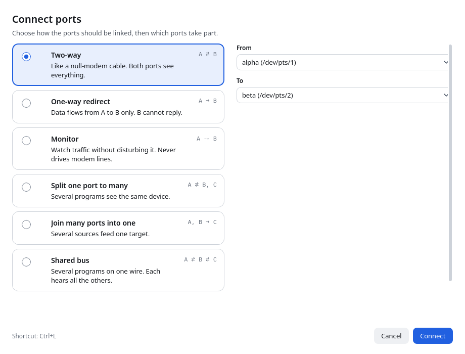

# Links between ports

## Building on the diagram (Advanced)

At the Advanced level you can build straight on the topology. Everything here
makes the same ports and links as the dialogs, so use whichever you prefer.

- **The toolbox** on the left of the diagram lists tiles. Under **Ports**:
  **Port**, **Fixture**, **Loopback**, **Device** and **Network**. Under
  **Bundles**: **Pair**, **Split**, **Join**, **Bus**, **Switch** (several
  programs sending to one port, one owner at a time), **Redirect**, **Monitor**,
  **Share** and **Bench** (several fixtures, each paired with its own port).
  **View → Show toolbox** (`Ctrl+Shift+B`) hides and shows it.
- **Add a tile**: drag it onto the diagram, or select it and press `Enter`. A
  small **Add** sheet asks for each end (a new port, a new fixture, a loopback or
  a port you already have) and a name, **How many** for a bundle with a count,
  and baud rate and framing under **More settings**. On Windows the sheet for a
  **Port** also has a **COM number** field, set to *Automatic*, with the free
  numbers in its list; a number that is in use is refused beside the field and
  the message says what holds it. For a **Monitor**, choosing a port that is
  there as the watched end shows that port's baud rate and framing, taken from
  the port, and uses them. **Add** makes the ports and
  the link in one step, and removes what it made if a step fails. **Device**,
  **Network** and **Share** open their own dialogs. **Topology → Add port**, **Add
  fixture** and **Add pair** do the same from the menu.
- **Link two boxes**: drag from the round handle on the edge of one box onto
  another, then choose **Two-way**, **One way, from A to B** or **Monitor A on
  B**. Dropping on empty space offers **New port here**, **New fixture here** and
  **New loopback here** (the ways of linking then read **Two-way**, **One way,
  to the new port** and **Monitor on the new port**), and also **Share <port>
  over the network...** and **Connect <port> to a server...**, which open the
  network dialog. Dropping on a port that is on a shared bus offers **Add <port>
  to the bus with <port>**, and dropping on a port that is not on one offers
  **Shared bus for <port> and <port>**. A drop that would close a loop is
  refused with "That link would create a loop". With several boxes selected, **Link selected** in
  the box's menu builds a split, a join, a bus or a switch. From the keyboard,
  **Connect from here** (`Ctrl+L`) asks for the other port.
- **Right-click a box** for **Inspect**, **Settings...** (baud rate, data bits,
  parity, stop bits, flow control and timeouts, as far as the kind of port has
  them), **Rename**, **Duplicate** (`Ctrl+D`; not for a real device or a network
  client, which can be opened only once), **Connect from here**, the port actions
  (**Send bytes**, **Start repeat**, **Open in monitor**, **Decode as...** when
  a plugin that decodes is on, and for a fixture **Start generator** and **Echo
  received bytes**), **Share over the network...**, **Connect to a server...**
  and **Make a bus with...**, **Pause** and **Stop** for a real device or a
  network port (see [Stopping and pausing a
  port](adding-ports.md#stopping-and-pausing-a-port-advanced)), **Copy name** and
  **Delete**.
  **Right-click a line** for **Settings...** (see [Delay and
  jitter](timing-and-control-lines.md#delay-and-jitter-on-a-link)), **Reverse direction** (a one-way link)
  and **Delete**. Right-click empty space to add a port, a fixture, a loopback or
  a bundle, or **Select all**.
- **Topology → Tidy layout** arranges the boxes, and **Fit** (`Ctrl+0`) fits them
  in the pane.
- **Zoom**: a small bar in the bottom-right corner of the diagram has **Zoom
  out**, the current zoom (press it to go back to 100 percent) and **Zoom in**.
  `Ctrl` with the mouse wheel, or a pinch on a trackpad, zooms about the
  pointer; `Ctrl+Plus` and `Ctrl+Minus` zoom, `Ctrl+1` returns to 100 percent
  and `Ctrl+0` still fits everything. The zoom runs from 25 to 400 percent.
- **Double-click** a box to open its **Settings...** (a network port opens its
  network settings), and a line to open the link's settings. A monitor line has
  no delay to set, so double-clicking it opens the port it watches in the
  monitor.

Most of these steps can be undone; see [What this build cannot do](limits.md#what-this-build-cannot-do).

## Connecting ports

**Topology → Connect ports…** (`Ctrl+L`, enabled once two ports exist) creates a
link:

| Relationship | Use it when | What the target sees |
|---|---|---|
| **Two-way** | Two ports should behave like a null-modem cable. | Everything, both directions. |
| **One-way redirect** | Data must flow from A to B only. | Writes from A; B cannot reply. |
| **Monitor** | You want to watch without disturbing. | A one-way copy that never drives modem lines. |
| **Split one port to many** | Several programs must see the same device. | Each target receives a copy of the source. |
| **Join many ports into one** | Several publishers feed one program. | The target receives every publisher's data. |
| **Shared bus** | Several programs share one wire, like stations on an RS-485 line. | Every other port's data; never its own. |

A monitor can copy only what the port's program writes (**Transmit only**),
only what is written into the port (**Receive only**) or both (**Both
directions**, the default). Choose it under **Direction** in **Settings...** for
the monitor line, or in the Inspector of the port at the copy end. In a topology
file it is `"direction"` on a monitor link, with `"both"`, `"transmit"` or
`"receive"`; a file without it means `"both"`, and any other value is refused.

The dialog lists only ports that exist, refuses a port linked to itself, needs
at least two targets for a split, two publishers for a join and two ports for a
bus, and prints a sentence describing the result before you commit. A link that
would make a loop is refused, with a message naming the pair, and nothing
changes.

A join has **Choose one owner at a time** under **More options** (Advanced):
only the owner's bytes reach the target and the others' are counted as dropped.
On a two-way link or a split the owner is one of the targets: only its bytes
reach the source and the others' are counted as dropped, while what the source
sends reaches every target.
The owner bar under the diagram says who the owner is, with **Give to** and
**Release owner**. A shared bus carries no modem lines and has no owner, and a
port can be on only one bus (at most 64 members). At the Advanced level the bus
page has **Half-duplex line**, which gives the bus a line rate and reports two
ports sending at once; see [RS-485 is half-duplex, and a bus can
be](timing-and-control-lines.md#rs-485-is-half-duplex-and-a-bus-can-be). Where the engine has no bus
(**What this build cannot do**), the choice is disabled with "Not available in
this build".

Remove a link by selecting its line and pressing `Delete`, or **Topology →
Remove link**. Removing a port asks first and removes its links too. When the
port belongs to something built together, such as a share, the question offers
**Remove only** that port or **Remove the whole setup** (also **Ports → Remove
setup**). Removing one program's port from a share keeps the others sharing. A
port on a shared bus just leaves the bus, which goes when fewer than two ports
remain.

## Link wiring and ownership (Advanced)

- **Topology → Link wiring** opens the line matrix and faults dialog (see [Mock
  fixture](adding-ports.md#mock-fixture-advanced)) for the selected port, or for the first
  fixture when nothing is selected. It sets which signals the port drives on the
  port at the other end of its two-way link.
- **Topology → Owner** goes to the owner bar under the diagram for a join or a
  split that uses an owner policy. The owner can be released or given to another
  port: on a join one of the sources, on a split one of the targets (never the
  device the targets share). A link with one target has no choice to make, so it
  has no bar.
- **Tools → Benchmark** sends data from one port and counts what arrives on
  another, so you can measure a cable or a driver pair. Choose the two ports,
  the amount (1, 10 or 100 MB) and the chunk size, then **Run**. The bar shows
  progress, and **Cancel** stops the run. The result is *Passed* when every byte
  arrived and *Failed* when some did not, with the number lost; **Copy result**
  puts the figures on the clipboard. The two ports must not be linked in
  Studio, because the data has to travel through the cable or the driver pair.
  It is the same measurement as `vss_cli bench`, and the dialog shows the
  matching command.

Some of these depend on what the engine can do; see
[what this build cannot do](limits.md#what-this-build-cannot-do).

## Data passes through a port

When a link writes bytes into a port, Studio sends them on along that port's
other links. If port 1 has a two-way link to port 4, port 4 has a two-way link to
a network server and port 4 is on a bus, the bytes from port 1 reach the server
and the other ports on the bus, and the bytes from the server reach port 1 and
the bus.

- A port never gets the same bytes twice, and bytes never go back to the port
  they came from, so a two-way link or a bus does not echo.
- A one-way link passes bytes on in its own direction only.
- A monitor on a port shows what the port reads and what is written into it,
  each once.
- The listeners of a split still do not hear each other.
- A delay on a link is added to the delay of the next link.

## Ports under running programs

A port of the Studio driver, and on Linux a pseudo terminal, tells Studio when a
program opens it. The Ports list and the Inspector then read **Waiting for
program** until something opens the port and **Program connected** once it does,
so with several programs to start you can see which one has not yet.

Studio's ports disappear with Studio, so a program that holds one loses it when
you remove the port, start a new setup or close the window. Old programs may
stop or show a bare error. Before any of those Studio names the ports that
programs hold and asks you to confirm; it asks nothing when no program is known
to hold a port. For a port Studio cannot observe (a hardware port, com0com, or
anything on macOS) it does not guess, so it does not warn either.

## When a program will not let go of a port (Advanced)

Windows frees a port at once when its program ends, so this is rare: a program
that is still running holds the port, and a second program cannot open it.
Turn on **Advanced**, select the port (it reads **Program connected**) and press
**Release port...** in the Inspector. The dialog names the program and its
process and says how long no data has passed on the port. That is only a fact:
Studio cannot tell a stuck program from a quiet one, so it never says the program
is stuck. Choose one way, then press the button:

- **Take the port back** (try this first). The program keeps running, but its
  connection to the port stops working, and another program can open the port at
  once with the same COM number. The Studio driver does this; Studio does not
  touch the program.
- **End the program.** Windows closes it straight away, as *End task* in Task
  Manager does, and it does not get to save anything. Studio ends only your
  own programs. For a program of another user, run Studio as administrator
  (**Restart as administrator** in **Tools → Setup check**); until then this
  choice is off and says why.
