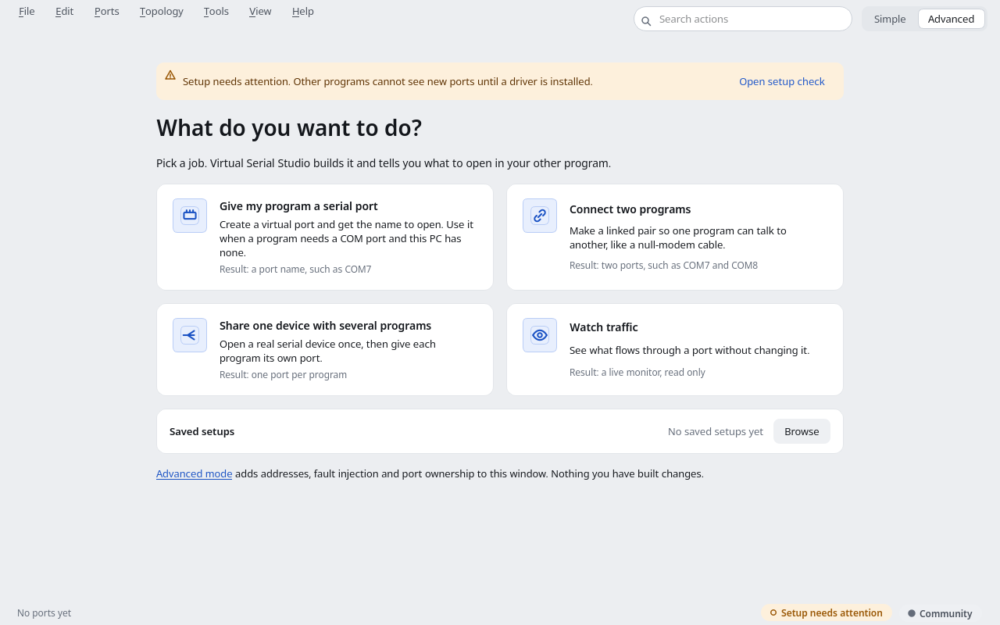
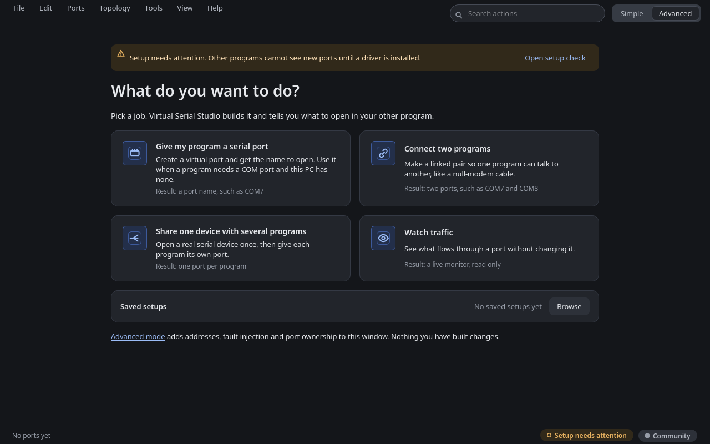
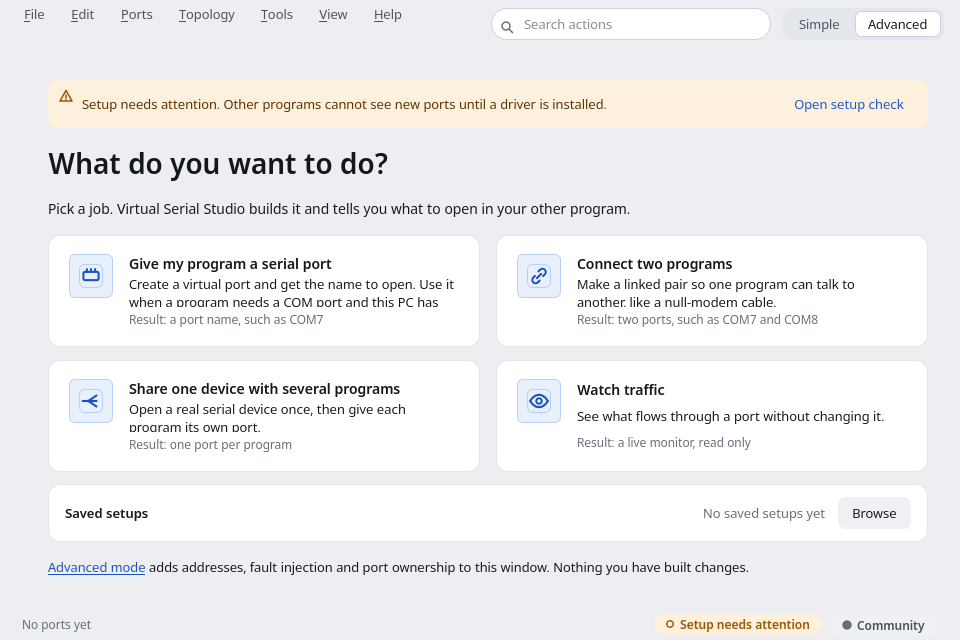
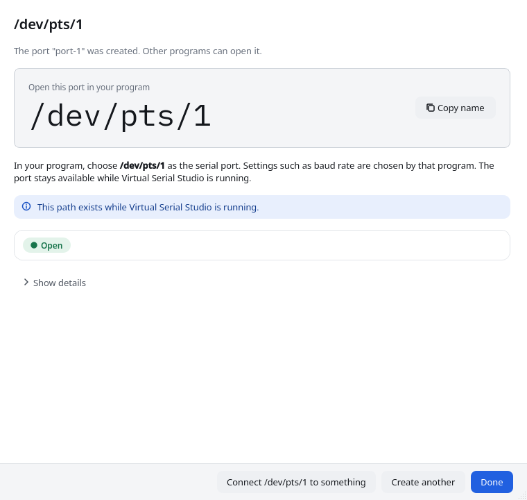

# Getting started

## Simple and Advanced

The window has a **Simple** level and an **Advanced** level. Simple is the
default and is built for one job: "I need a serial port, now." It is a list of
your setups and a page of jobs. Advanced is a diagram you build on, with the
panes an integrator or a diagnostician needs. Both show the same studio.
Nothing you have built changes when you switch, and a setup made at one level
opens at the other.

| | Simple | Advanced |
|---|---|---|
| Main area | **Your setups** (a list) and a page: the jobs, a job form, or the page of one setup | The topology diagram with a toolbox, and the Ports, Inspector, Send and Monitor panes |
| Add a virtual port, a linked pair or a real device | Jobs on the job grid | The launcher, the **Ports** menu and the toolbox |
| Connect ports, share a device, watch traffic | Jobs (and the Topology menu) | The **Topology** menu, the toolbox, and the diagram itself |
| Send text and see traffic | **Type to** and **Data going through** on a setup's page | The Send panel and the Monitor |
| Control lines, Break, line wiring, faults, owner, benchmark, Export as command, Log, Topology JSON | Hidden | Shown |
| Network endpoint and mock fixture | Hidden | Shown |
| Dialogs | Guided, with defaults | Editable addresses and More options |

Switch with **View → Advanced mode** (`Ctrl+Shift+A`), the **Simple | Advanced**
switch at the right end of the menu bar, **Settings**, or the **Turn on Advanced
mode** and **Advanced mode** links in the launcher and the dialogs. The choice is
remembered and applies to every document. Commands hidden in Simple still appear
in the command palette, under "Needs Advanced mode", with a button that turns it
on.

## The window at a glance

### Simple

```
┌──────────────────────────────────────────────────────────────────────┐
│ File Edit Ports Topology Tools View Help  [Search] [Simple|Advanced] │
├───────────────────┬──────────────────────────────────────────────────┤
│ Your setups       │ What do you want to do?                          │
│ COM7 shared (2)   │  My program needs a serial port                  │
│   COM8 (PuTTY)    │  I have a serial device                          │
│                   │  Several programs or devices at once             │
│ Save... Open...   │  Look and check                                  │
│       Remove all  │                                                  │
├───────────────────┴──────────────────────────────────────────────────┤
│ Ports 2  Links 1  RX  TX  Engine running                 Setup ready │
└──────────────────────────────────────────────────────────────────────┘
```

- **Your setups** (left): one row per setup, that is, the ports that were built
  together and the links between them, with the ports it holds underneath. A
  setup made at the Advanced level that no job describes carries the title "Made
  in Advanced mode". **New** goes back to the jobs. **Save…**, **Open…** and
  **Remove all** are below the list.
- **The page** (right) is one of three things: the job grid, a job form, or the
  page of the setup you selected (see [Jobs](#jobs-simple)).
- The status bar shows the port and link counts, the receive and transmit rates,
  whether the engine is running ("Engine running" or "Engine stopped") and a
  readiness chip that opens the setup check. With no ports it says "No ports
  yet" and nothing else on the left. A short message, such as "Copied COM7.",
  takes the place of those counts for a few seconds and then the counts come
  back. The chips on the right stay.

### Advanced

```
┌──────────────────────────────────────────────────────────────────────┐
│ File Edit Ports Topology Tools View Help  [Search] [Simple|Advanced] │
├───────────────┬──────────────────────────────────────┬───────────────┤
│ Ports         │ Attach Connect|Mock Share Fit        │ Inspector     │
│ port  state   │ +----+ [port A]---[port B]           │ state, path   │
│ RX TX Dropped │ |Tool|                               │ traffic, lines│
│               │ |box |                               │               │
│               │ +----+  owner bar                    │ Send          │
│               │                                      │               │
├───────────────┴──────────────────────────────────────┴───────────────┤
│ Monitor | Log | Topology JSON                                        │
├──────────────────────────────────────────────────────────────────────┤
│ Ports 2  Links 1  RX  TX  Engine running                 Setup ready │
└──────────────────────────────────────────────────────────────────────┘
```

- **Ports** (left): one row per port with its name, what it is for and its
  path (with a copy button), then its state, RX, TX and Dropped. **Filter
  ports** narrows the list, and `Esc` clears the filter. The path is what your
  other program opens. Select a port here, in the topology or in the monitor,
  and the other two follow. Click a column heading to sort by it, click again to
  reverse and a third time to go back to the order Studio keeps (`Ctrl+Alt+S`
  does the same from the keyboard). Drag a heading to move the column, drag its
  divider (or `Ctrl+Alt+Left` and `Ctrl+Alt+Right`) to resize it, and right-click
  a heading, or press `Ctrl+Alt+M`, to choose the columns: Kind, Address,
  Settings, Baud rate, Data bits, Parity, Stop bits, Flow control and Errors can
  be added, and **Reset columns** puts them back. The order, the columns and
  their widths are kept for the next start.
- **Topology** (centre): one box per port and one line per link. Click a box to
  inspect it and a line to select the link. The row of buttons above it holds
  **Attach real device**, **Connect ports**, **Mock fixture**, **Share a
  device**, **Fit**, **Remove port** and **Remove setup**. The toolbox on its
  left builds on the diagram; see [Building on the diagram](connecting-ports.md#building-on-the-diagram-advanced).
  **View → Panes → Show links as a list** gives the same links as a list that a
  screen reader can walk.
- **Inspector** (right): details for the selected port and its control lines.
  A port that nothing has opened yet links to "Why is nothing arriving?".
- **Send** (right): write bytes into an open port.
- **Monitor** (bottom): traffic rows with time, port, direction, bytes and a
  preview. **Log** and **Topology JSON** are panes of their own that start in
  the same tabs at the bottom; show or hide each from **View → Panes**. The
  **Log** has a port picker, an **Events** menu (**Errors**, **Started**,
  **Stopped** and **Other**), a search box and **Clear**. When the JSON has an
  error, the editor names the line, marks it, and **Go to line** jumps to it.
  That covers syntax mistakes, bad names, kinds, modes and links, and invalid
  serial settings.
- **Status bar**: port and link counts, receive and transmit rates, whether the
  engine is running ("Engine running" or "Engine stopped"), a chip that counts
  bytes dropped when there are any, a readiness chip that opens the setup
  check, a chip that reads **Reading data** or **Recording** while a plugin does
  (see [Plugins](plugins.md)), the edition chip (see [Licences](licences.md)),
  an **Update available** chip when a check has found one (see
  [Updates](updates.md)) and, while profiling is on, its address. A short message
  takes the place of the counts on the left until it goes, and then the counts
  come back. The chips on the right stay.

### Moving the panes

**Ports**, **Inspector**, **Send**, **Monitor**, **Log**, **Topology JSON** and
the links list are panes that you can move; the topology stays in the middle.
Each has a title bar with a menu and a close button. Drag the title bar, or a
tab, and drop guides appear: the centre square puts the pane in the same tabs as
the pane under the pointer, the four squares around it put it left, right, above
or below that pane, and squares at the edges of the window dock it there. A
shaded area shows where it will land, and a pane dropped outside the window
floats. From the keyboard, open the pane's menu and choose **Float** (or
**Dock**), **Move to the window edge** (**Left**, **Right**, **Top**,
**Bottom**) or **Beside** another pane (**Tab with**, **Left of**, **Right
of**, **Above**, **Below**). **View → Panes** lists every pane with a check mark
for each one that is open, so a pane you closed comes back from there;
**Next pane** and **Previous pane** (`Ctrl+Tab` and `Ctrl+Shift+Tab`) move
between them. The arrangement is kept between runs, and **View → Reset layout**
puts the panes back where they start.

To rename a port, select it and press `F2`, or use **Ports → Rename port** or
the node's context menu. Links and the saved setup use the new name. A
pseudo terminal on Linux or macOS moves its stable path to the new name, so
a program that opened it by that path needs the new one. The path of every
other kind stays as it was made.

The window opens at 1280 by 800 and works down to 960 by 640. Pane sizes are
remembered; **View → Reset layout** puts them back. **Theme** (follow the
system, light or dark) and **Density** (comfortable or compact) are under
**View** too.

## Jobs (Simple)

At the Simple level the page on the right starts as the job grid. It opens with
a strip that says whether this PC is ready to create ports other programs can
open (**Details**, or **Open setup check** when something is missing), then the
jobs in four groups:

| Group | Job | What Studio builds |
|---|---|---|
| My program needs a serial port | **Give my program a serial port** | One virtual port. |
| | **Connect two programs to each other** | Two virtual ports linked two-way, like a null-modem cable. |
| I have a serial device | **Use my device through a new port** | The device and one virtual port for your program. |
| | **Share my device with several programs** | The device and a virtual port for each program. |
| | **Try my device from this window** | The device alone, to type to and read from here. |
| | **Let other computers use my device** | The device bridged to a network port (default 4001). |
| Several programs or devices at once | **Put several on one line** | A [shared bus](connecting-ports.md#connecting-ports), like an RS-485 line. |
| | **Send several into one** | A join: everything the senders write reaches one receiver. |
| | **Let programs take turns sending to a device** | A split from the device to the programs with an owner, so one program sends at a time and all of them get the device's replies. |
| Look and check | **See the data on a port** | Nothing new: it opens **Data going through** on a setup you already have, which only looks. |
| | **Check this PC is ready** | Opens the setup check. |

**Put several on one line** is disabled with "Not available in this build"
where the engine has no bus, and **Let other computers use my device** where it
has no network endpoints. Below the jobs, **Open a saved setup…** and **Start
from an example…** open the file chooser and the [templates](setups.md#saving-opening-and-templates).

A job opens a form. Its parts depend on the job:

- **The device**: **Plugged into this PC** (a list with **Refresh**) or **On
  the network** (an address, a port and TCP or RFC 2217).
- **The programs**: a row for each, with a port name and an optional program
  name such as PuTTY, which is only a label. **Add a program** adds a row, up to
  32 (64 for **Put several on one line**), and **Add a device** where a device
  may take part: on one line, and when sending several into one. With the Studio
  driver on Windows the port name is a list of the next free COM numbers;
  elsewhere Studio picks the name.
- **On the other end** (give my program a port): **I'll type to it from this
  window**, or **Send everything straight back**, which makes a mock fixture
  that echoes.
- **Device speed (baud rate)** and **Other device settings**, **Name (optional)**,
  and tick boxes such as **Let me type to the device from this window** and
  **Show me the data going through**.

A sentence at the bottom says what will be built. **Create** builds it, and if a
step fails Studio removes what it made. On Windows each new port can take up to
a minute to install, so while Studio builds, the button reads **Creating**
(**Applying** when you change a setup), the rest of the form is off and the
window stays responsive.

The page of a setup says what to do next:

- **What to do now**: for each program, "In PuTTY, open **COM7** at 115200
  baud", and a reminder not to open the device itself.
- **Ports**: each port with its name, a copy button and a chip: **No program
  yet** until a program opens it, then **Open in a program** (just **Open**
  where Studio cannot see that). A device row shows **Open at 115200 baud**. A
  network listener shows how many computers are connected. When a program has
  set a different baud rate from the device's, a note says so. **Add a
  program** adds a port without interrupting the others, and the minus button
  closes one.
- For programs that take turns, each row has a **Let this one send** button and
  the program that has the turn shows **Sending now**. The others only listen.
  Closing the program that has the turn gives it to the first one left.
- **Type to** a port: a box for what you type and a view of what comes back.
  **Enter adds a line ending** is a switch.
- **Data going through**: **Show me the data going through** starts a live
  list of what is sent each way, with **Pause**, **Clear**, **Show as hex** and
  **Hide**. It only looks.
- **Change…** reopens the job form for the setup. **Remove setup** closes it,
  naming the ports it closes. A setup made at the Advanced level has **Change in
  Advanced mode** instead, and the page ends with **See it on the canvas
  (Advanced mode)**.

## The launcher (Advanced)

At the Advanced level an empty studio shows the empty diagram and its toolbox.
**View → Show launcher** and **File → New** bring up the launcher, a page like
the job grid with four jobs:

1. **Give my program a serial port.** Creates a virtual port and tells you the
   name to open.
2. **Connect two programs.** Creates a linked pair, like a null-modem cable.
3. **Share one device with several programs.** Opens the share wizard.
4. **Watch traffic.** Starts a read-only copy of a port's traffic.

It opens with a strip that says whether this PC is ready to create ports other
programs can open. Below the cards, **Saved setups** shows your most recent file
with **Open** and **Browse**. The launcher goes away when the first port exists.



The launcher in the dark theme:



The launcher in the compact density at the smallest window size, 960 by 640:



## Quick start

1. Choose **Give my program a serial port**, optionally give the port a name (on
   Windows with the Studio driver, pick a COM number), and press **Create**. At
   the Advanced level use **Ports → Add port** (`Ctrl+Shift+N`) and **Create
   port**; a dialog titled with the name to open (**COM7 is ready**, or the path
   itself on Linux and macOS) opens instead of a setup page.
2. Studio shows the name to open, for example `COM7` on Windows or `/dev/pts/3`
   on Linux. Press the copy button, or **Copy name** in that dialog.
3. In the other program, choose that port. Whatever it writes appears in the
   setup's **Type to** view, or in the monitor.
4. To try the port without another program, choose **I'll type to it from this
   window** when you create it, then type in **Type to**. At the Advanced level,
   use the **Send** panel: pick the port, type text, press **Send**, and watch
   the monitor.

On Linux that dialog, whose title is the path, looks like this:


