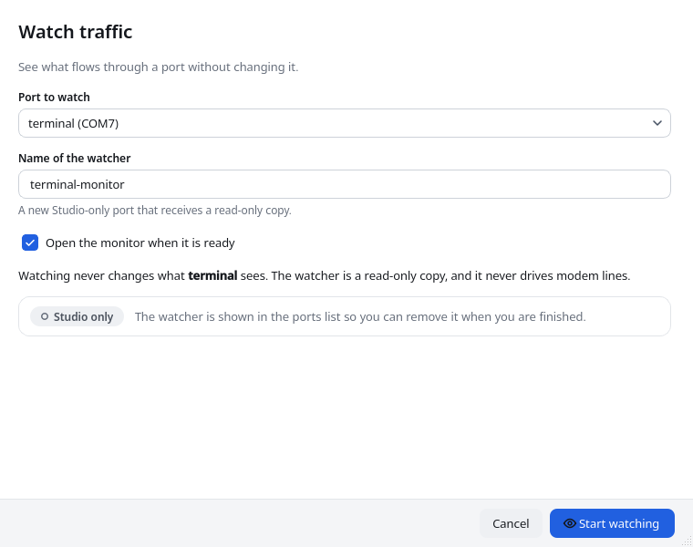

# Monitor and capture

## Watching traffic

**Topology → Watch traffic** makes a read-only copy of a port. Choose the port
and a name for the watcher (the dialog suggests `<port>-monitor`) and press
**Start watching**. The watcher is a Studio-only port, shown in the
ports list so you can remove it when you have finished, and it never drives
modem lines. With **Open the monitor when it is ready** ticked, Studio selects
the watched port and brings the monitor forward. The monitor is not filtered to
that port; you can set the port filter yourself. At the Simple level,
**Show me the data going through** on a setup's page also shows the traffic, without making a watcher port.

## The monitor and the Send panel

The **Monitor** shows a row per transfer: **Time**, **Port**, **Direction**
(`RX`, `TX`, or `DROP`), **Bytes** and **Preview**. A `DROP` row is one line each
time a link's dropped count grows, for bytes that a port without the owner's
right to write tried to send. It shows the count and not the bytes, because the
hub does not publish them.

- **Pause** (or `Space` in the table) stops appending. Traffic still flows and
  is counted. **Clear** empties the view. **Follow** keeps the newest row
  visible.
- The preview switch shows payloads as **ASCII** or **Hex**. You can filter by
  port and by RX, TX or Dropped, search the payload (`Ctrl+F`), and **Export**
  the visible rows as text. **Export capture** saves the same rows as a capture
  file (see [Capture files](#capture-files)).
- The monitor keeps the latest 10,000 rows, and no more than 32 MiB of their
  bytes, oldest first. The **Preview** column stops at 256 bytes, but the
  rows keep every byte for **Export capture**. For a record that does not stop
  at what the window holds, use `vss_cli capture`.

### Capture files

A capture is the traffic written with its exact time, in a form another
program can read. The monitor's **Export** is for reading: its **Time** is when
the window received a batch, and it cuts each payload to the preview. **Export
capture** and `vss_cli capture` write every byte, and the time is the one the
engine read when the bytes moved. That is a single clock for every port,
including a port whose other end is on another computer: the remote machine's
own clock is never used.

Each record has an offset in milliseconds from the start of the capture, the
port, a direction and the bytes of one transfer. The direction is from the
port's point of view:

- **R** is bytes the port *received*, from whatever is attached to it: the
  program that opened it, a device, a remote client.
- **W** is bytes *written to* the port, which the hub sent on to that attachment.

On a link, one transmission is `R` on the sender's port and `W` on the port of
every receiver, and a watcher port made with **Watch traffic** shows it once, as
`W`. To keep one row for each message, capture only the port you want
(`--port` on the command line); in the window, set the port filter first, as
the export writes the rows that pass the filters.

| Format | What it holds |
|---|---|
| `.cap` | Text: `[         142] R 0x10\|0x02\|0x50`, one line per transfer. The offset is right aligned in ten columns, the bytes are lower-case hexadecimal, and lines starting with `#` are comments. The file has no port names, so capture one port per file. |
| `.csv` | A header row, then `time_utc,offset_ms,port,direction,bytes,hex` for each transfer: the absolute time, the offset, the port name, `R` or `W`, the length, and the bytes as `10 02 50`. |
| `.jsonl` | One JSON object per line. The first has `started_utc`, the wall clock at offset zero. Each later one has `offset_ms`, `time_utc`, `port`, `direction`, `bytes` and `hex`. |

Offsets are whole milliseconds, so two transfers in the same millisecond have
the same offset; the order of the lines is the order the engine delivered them.

**Send** writes bytes into an open port. The line above it says "Sending from"
the selected port, and the list beside **Send** can change it; **Pin** keeps
sending from that port when you select another. Type text, or tick **Hex** for
hexadecimal (it is checked as you type), leave **Add CRLF** ticked to end the
line, and press **Send**. **Repeat** sends every 50 to 5000 ms until you press
**Stop repeat**, and **Saved sends** keeps your favourites. Engine errors appear
as a message and in the log. At the Simple level, **Type to** on a setup's page
does the same for its port.
