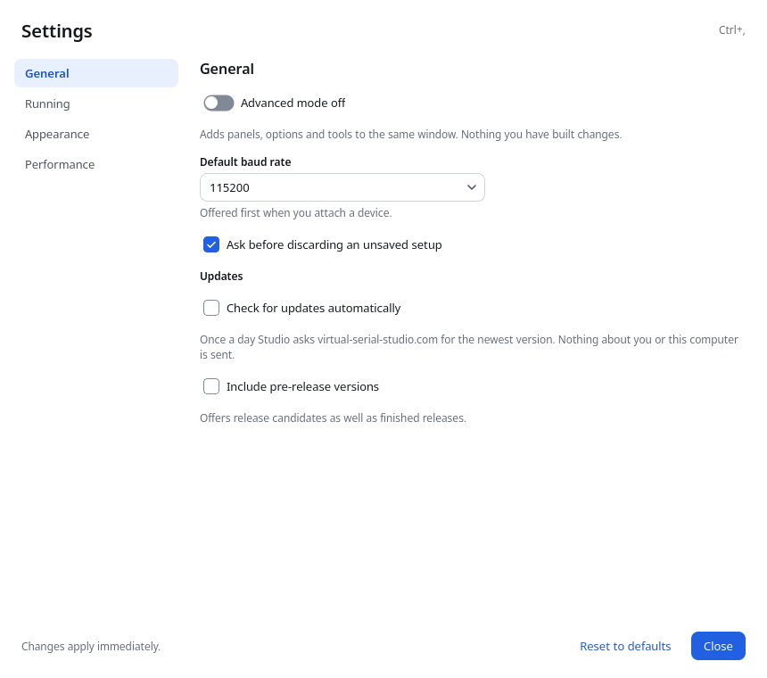
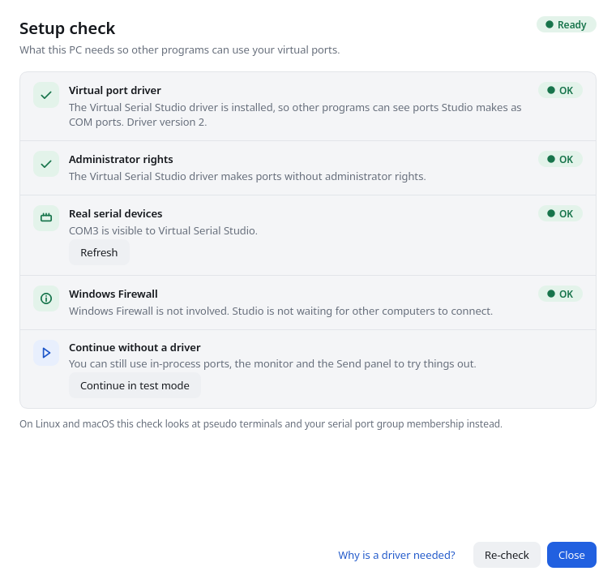
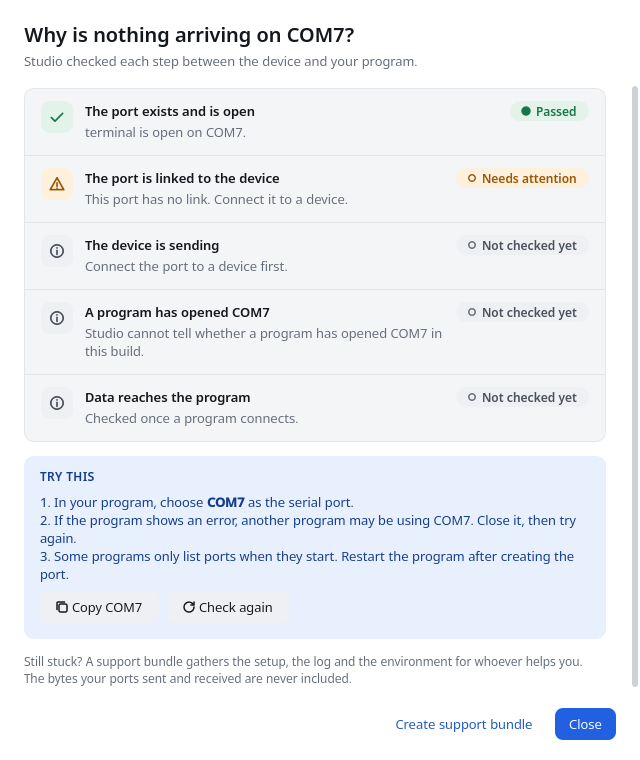

# Settings and help

## Finding things: the command palette

`Ctrl+K`, or the **Search actions** box in the menu bar, opens a list of every
action. Type a few letters, use the arrow keys and press `Enter`. Actions that
need Advanced mode are listed under **Needs Advanced mode**, with a button that
turns it on.

## Settings

**Tools → Settings** (`Ctrl+,`) has four pages. Changes apply immediately.

- **General**: *Advanced mode*, *Default baud rate* (offered first when you
  attach a device) and *Ask before discarding an unsaved setup*.
- **Running**: *When I close the window* (*Keep the ports running in the
  background* or *Stop the ports and quit*) and *Start when I sign in*; see
  [When the window is closed](setups.md#when-the-window-is-closed).
- **Appearance**: *Theme* (follow the system, light or dark), *Density*
  (comfortable or compact) and *Link lines* (curved, the default, or right
  angles with rounded corners). Text size, display scale, high contrast and reduced
  motion follow your operating system.
- **Performance**: *Refresh interval*, 50 to 5000 ms. Shorter feels live;
  longer is lighter on a busy machine. Under *Profiling*, *Record a performance
  trace* lets a Tracy profiler watch where Studio spends its time, which is how
  a slowdown is found. It is off every time Studio starts, listens on this
  computer only, and sends nothing until you connect the profiler; the status
  bar shows the address while it is listening. *Let other computers connect*
  opens it to your network and can be chosen only before the first start.
  Turning the trace off stops recording, but the port stays open until Studio
  quits. Builds without the profiler show both switches as unavailable. See
  [profiling](../profiling.md).

The last group in the dialog, **Updates**, has *Check for updates automatically*
and *Include pre-release versions*. See [Updates](updates.md#updates).

**Reset to defaults** restores them. The values are stored with `QSettings` (the
registry on Windows, a configuration file on Linux and macOS).

## Help and diagnostics

- **Tools → Setup check** says what this PC needs so other programs can use
  your ports. On Windows it looks for the Virtual Serial Studio driver (and
  names its version) or com0com, whether administrator rights will be needed,
  and the real serial devices. Either driver counts as ready, and the com0com
  install guidance appears only when neither is found. It also says whether
  Windows Firewall lets other computers reach a port you listen on. On Linux and macOS it
  looks at pseudo terminals and your serial port group. The status bar chip
  shows "Setup ready" or "Setup needs attention" and opens the same dialog.

- **Help → Why is nothing arriving?** walks the steps between the device and
  your program (the port is open, it is linked, the device is sending) and
  suggests what to try. On Linux Studio can see whether a program has opened
  a pseudo terminal, and on Windows whether one has opened a port of the Studio
  driver, so those checks say so. Everywhere else it cannot, and the last two
  checks read "Not checked yet".

- **File → Support bundle** saves a ZIP named `vss-support-<date>.zip` with
  the version and environment, the driver state, the setup, the event log, the
  port counters and the serial ports on this computer (and, if you turn it on,
  the calls Studio made to Windows that failed), and the licence number,
  edition, term and state when a licence is installed. The bytes your ports
  sent and received are never included, and passwords, the path of your home
  folder, your computer and user names, device serial numbers and the licence
  file are left out. Two amber choices, off until you turn them on, add the
  licensee name and this computer's name. The right side of the dialog shows
  each file exactly as it will be saved. Nothing is sent anywhere; you choose
  where to save the file.
- **Settings → Performance → Debug access** lets programs on this computer ask
  a running Studio what its ports, its engine and Windows are doing. Use it to
  find out why a port will not open, why Windows refuses a COM number, or why a
  network client does not connect. It is off every time Studio starts. While it
  is on, the status bar shows **Debug access on**, and pressing that turns it
  off. A program that wants to use it asks first, and you choose **Don't
  allow**, **Allow once** or **Allow until Studio quits**. Each use is written to
  a log in Studio's data folder. It uses a pipe only you can open, and nothing
  is sent anywhere. A second switch lets a program read the bytes your ports
  carry, for ten minutes at most. `vss_cli debug` is the command line client:
  `vss_cli debug snapshot` shows every port with its state, counters and last
  error, `vss_cli debug trace --follow` shows the calls Studio makes to Windows
  as they happen, with the code Windows gave for each one that fails, and
  `vss_cli debug com` shows which COM numbers Windows keeps and why. See
  [A debug API for a running Studio](../debug-api.md).
- **Help → Support...** says where to get help for your edition, what to write
  before you ask, and has the **Create support bundle** button and a **Copy**
  button for the version, edition, licence number and operating system. It
  copies addresses to the clipboard and does not open a web page or a mail
  program.

- **Help → Keyboard shortcuts** lists every shortcut; **Help → Copy
  diagnostic information** copies the build information and the environment for
  a bug report.
- **Help → About** shows the application icon, the version and the licence
  at the top, and has six tabs: About (the GPLv3 notice and a link to the
  source code), Updates (see [Updates](updates.md#updates)), Build information (the version, Git tag, commit, branch,
  whether the tree was modified, CI build number, build time, build type,
  compiler, and the Qt and Boost it was built with), Environment (operating
  system, architecture, Qt running, display and the language chosen), Licences
  (the components this build contains: Qt, Boost, Boost.VirtualSerial and, in a
  build with profiling, Tracy) and Fonts (IBM Plex Mono, Noto Sans Arabic and Noto Sans Hebrew, which are built into the program). The version reads
  like `v0.1.0-rc.5+18.gabc1234.build.123`: the release, the number of commits
  after it, the short commit and the CI run number. A plugin's version is written the
  same way, so a build of a plugin shows which commit it was made from. Each of the two data tabs has a button that copies it, and
  **Copy diagnostic information** copies both.

The application is available in nine languages (English, French, Spanish,
German, Hebrew, Yiddish, Japanese, Simplified Chinese and Arabic). It follows
the system language, and there is no language setting in the window. See
[i18n.md](../i18n.md).

## Keyboard shortcuts

`Ctrl` is `Cmd` on macOS.

| Shortcut | Action |
|---|---|
| `Ctrl+N` / `Ctrl+O` | New / Open |
| `Ctrl+S` / `Ctrl+Shift+S` | Save / Save as |
| `Ctrl+Q` | Quit (the platform's Quit shortcut) |
| `Ctrl+Shift+N` | Add port |
| `Ctrl+Shift+C` | Copy port name |
| `F2` | Rename the selected port |
| `Delete` | Remove the selected port or link |
| `Ctrl+Z` / `Ctrl+Shift+Z` | Undo / Redo the last change that can be undone |
| `Ctrl+L` | Connect ports |
| `Ctrl+K` | Search actions |
| `Ctrl+,` | Settings |
| `F5` | Refresh now |
| `Ctrl+Shift+A` | Advanced mode |
| `Ctrl+0` | Fit the topology (Advanced) |
| `Ctrl+D` | Duplicate the selected ports (Advanced) |
| `Ctrl+Shift+B` | Show or hide the toolbox (Advanced) |
| `Enter`, `Alt+Enter` | In the topology: inspect, open Settings for the selected port (Advanced) |
| `F1` | Help contents |
| `Space`, `Ctrl+F` | In the monitor: pause, search |
