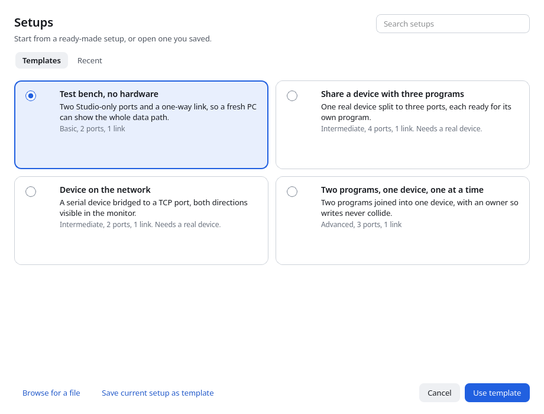
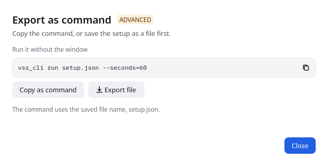

# Setups

## Saving, opening and templates

A setup is a JSON document that lists the ports and links.

- **File → Save** (`Ctrl+S`) and **Save as** (`Ctrl+Shift+S`) write the current
  setup. **File → Open** (`Ctrl+O`) applies a saved one; **Open recent** opens
  the latest.
- The title bar shows `*` while there are unsaved changes. Closing, **New** and
  **Open** ask first, and you can turn that off in Settings.
- **File → Setups and templates** opens **Setups**, with a **Templates** tab and
  a **Recent** tab (and **Save current setup as template**). The templates are a
  test bench with no hardware, a device shared with three programs, a device on
  the network, and two programs sharing one device one at a time. A template
  that needs a real device says "Needs a real device" and cannot be used yet;
  **Use template** opens one that does not.



- **File → Export as command** (Advanced) shows the `vss_cli` command that
  builds the current setup.



The same file can be replayed without the window:

```bash
vss_cli run topology.json --seconds=60
```

### Plugins in a setup file

A port or a link in a setup file may have a list named `plugins`. It records
what a plugin provides there, so that someone you send the file to can see which
plugins the setup needs and where to get them. The list is optional. A setup
without plugins has no such list and is written exactly as before, and the
file's `version` is still 1.

```json
{ "name": "meter-17", "kind": "mock",
  "plugins": [
    { "id": "com.example.modbus-fixture", "kind": "fixture", "type": "meter",
      "name": "Modbus fixture", "publisher": "Example Ltd",
      "key_id": "9f2c41d07a6be835", "version": "1.2.0",
      "get_it_from": "https://example.com/plugins",
      "params": { "address": 17 } }
  ] }
```

| Member | Meaning |
|---|---|
| `id` | The plugin's identifier: lower-case names of letters and digits joined by `.` or `-`, with at least one dot. Needed |
| `kind` | What the plugin provides here. `fixture` and `generator` belong on a port, and a port has at most one of them. `modifier` belongs on a link. `decoder` may be on either. Needed |
| `type` | Which of the plugin's types. Needed |
| `name`, `publisher`, `version` | For a person who opens the setup without the plugin. Plain text |
| `key_id` | The key a signed plugin was signed with, so that a different plugin with the same `id` is noticed |
| `get_it_from` | Where to get the plugin. It is shown as text. Studio never opens it |
| `on_timeout` | For a `modifier`: `fail_open` or `fail_closed` |
| `params` | The plugin's settings, as one JSON object of at most 64 KiB and 8 levels |

A port or a link may have up to 16 entries. On a link the order of the list is
the order in which `modifier` entries are applied.

Reading a setup never needs the plugin. An entry for a plugin that is not
installed, and a `kind` from a newer version of Studio, are read and written
back as they are. An entry that is malformed (no `id`, a `name` with a control
character, `params` that is not an object) is an error, like any other mistake
in the file.

Studio does not yet run a plugin that a setup names for a port or a link. It
checks the list when it reads a setup and keeps it with the port or the link,
so a setup that is opened and saved again,
from the window or from the command line, still has it. The list goes with its
port or link: remove the link and make it again, and the new link has none. A
version of Studio from before this change opens such a file, ignores the list,
and leaves it out when it saves.

## When the window is closed

Your ports run on this computer until you quit Studio or open another setup.
The window is only for setting them up and watching them.

- **Closing the window** with ports running keeps them running. Studio stays in
  the notification area (the menu bar on macOS); click its icon, or start
  Studio again from the Start menu, to bring the window back with everything
  live. There is only one Studio at a time. With no ports, closing quits.
- **Quitting** (**File → Quit**, `Ctrl+Q`, or **Stop the ports and quit** in
  the icon's menu) stops every port and link. Studio asks first.
- **The running setup** is kept by itself, a second after each change. After a
  restart, a sign-out or a crash, the same ports start again the next time
  Studio starts. After a Quit they do not start by themselves: a banner offers
  **Start again**.
- **Start when I sign in** (in the icon's menu, or **Settings → Running**)
  starts Studio hidden when you sign in, so the ports are back after a restart
  without opening anything. It is off until you turn it on, and it is not
  available on macOS yet.
- **Saved setups** are unchanged: **File → Open** replaces what runs with the
  saved setup, which then runs until you quit or open another, and you can
  change it and save it again.
- **Settings → Running → When I close the window** can make closing quit, as
  before.
- On a desktop with no notification area, closing with ports running asks
  whether to minimise instead.

`vss_cli run setup.json --seconds=60` runs a setup without any window, in its own
process, and exits after the time you give. Studio cannot see those ports.

## When the ports are taken away

A port of the Windows driver lives as long as the helper service or the driver
that made it. If the helper service stops (Windows starts it again after five
seconds) or the driver is restarted, every port it made is removed under the
programs that had them open. Studio sees the ports stop, keeps them in the
setup with their links and COM numbers, and shows a banner above the diagram:

> Some COM ports were lost. The helper service or the driver was restarted and
> removed the ports your programs had open.

**Recreate ports** makes each one again with the COM number it asked for, and
puts it back under the same name and links, so nothing has to be connected
again. A port without a requested number can come back under a different COM
name, because Windows gives the lowest free number: ask for a number if a
program opens a fixed name (see *Choosing a COM number*). A program that had the
old port open has to open it again; Studio cannot do that for it. If a port
cannot be made, the banner stays and the status bar says why.

Connections that Studio makes itself can be retried. `vss_cli run
topology.json --reconnect` opens a `tcp://` or `rfc2217://` client again when
its connection drops, after one second and then twice as long each time, up to
thirty seconds, and logs each try as an event. Listeners and serial devices
are not retried. In the engine, `studio::set_reconnect_policy` sets the delays
and the most tries, and `studio::reopen` opens any port that has an address
again by hand.
